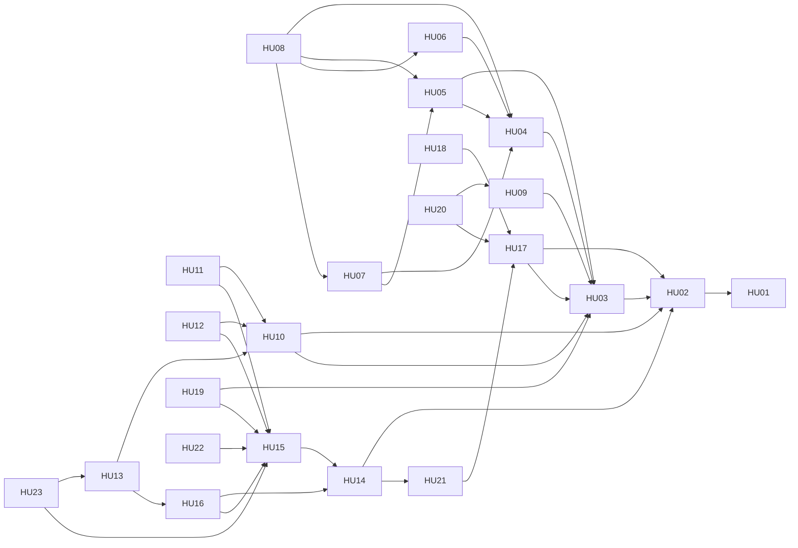

# Historias de usuario — FixFlow

Cada HU vive en su propio archivo `HU-XX-<slug>.md`. Cada HU corresponde a un Issue de GitHub; su estado se gestiona en GitHub Projects.

> El archivo `Historias de Usuario — FixFlow.md` es el documento consolidado original (organizado por épicas). Se conserva como referencia histórica. **La fuente de verdad son los archivos individuales.**

## Índice por módulo

### Autenticación y usuarios

| ID | Historia | Actor |
| --- | --- | --- |
| [HU-01](HU-01-registro-ciudadano.md) | Registro de ciudadano | Ciudadano |
| [HU-02](HU-02-inicio-sesion.md) | Inicio de sesión | Usuario registrado |

### Reportes e incidencias

| ID | Historia | Actor |
| --- | --- | --- |
| [HU-03](HU-03-crear-reporte-incidencia.md) | Crear reporte de incidencia | Ciudadano |

### Captura y sensores

| ID | Historia | Actor |
| --- | --- | --- |
| [HU-04](HU-04-capturar-evidencia-fotografica.md) | Capturar evidencia fotográfica en vivo | Ciudadano |
| [HU-05](HU-05-registrar-ubicacion.md) | Registrar ubicación automáticamente | Ciudadano |
| [HU-06](HU-06-validar-orientacion-dispositivo.md) | Validar orientación del dispositivo | Sistema |
| [HU-07](HU-07-asociar-coordenadas-evidencia.md) | Asociar coordenadas a la evidencia | Sistema |
| [HU-08](HU-08-validar-evidencia-reporte.md) | Validar evidencia del reporte | Sistema |

### Priorización

| ID | Historia | Actor |
| --- | --- | --- |
| [HU-09](HU-09-determinar-prioridad.md) | Determinar prioridad de una incidencia | Administrador municipal |

### Seguimiento ciudadano

| ID | Historia | Actor |
| --- | --- | --- |
| [HU-10](HU-10-consultar-mis-reportes.md) | Consultar mis reportes | Ciudadano |
| [HU-11](HU-11-consultar-estado-incidencia.md) | Consultar estado de una incidencia | Ciudadano |
| [HU-12](HU-12-recibir-notificaciones.md) | Recibir notificaciones | Ciudadano |
| [HU-13](HU-13-validar-resolucion.md) | Validar resolución | Ciudadano |
| [HU-23](HU-23-reabrir-incidencia.md) | Reabrir una incidencia no resuelta | Ciudadano |

### Atención operativa

| ID | Historia | Actor |
| --- | --- | --- |
| [HU-14](HU-14-consultar-incidencias-asignadas.md) | Consultar incidencias asignadas | Personal operativo |
| [HU-15](HU-15-actualizar-estado-incidencia.md) | Actualizar estado de una incidencia | Personal operativo |
| [HU-16](HU-16-registrar-solucion.md) | Registrar solución de una incidencia | Personal operativo |

### Administración municipal

| ID | Historia | Actor |
| --- | --- | --- |
| [HU-17](HU-17-visualizar-incidencias-municipales.md) | Visualizar incidencias municipales | Administrador municipal |
| [HU-18](HU-18-filtrar-incidencias.md) | Filtrar incidencias | Administrador municipal |
| [HU-19](HU-19-consultar-indicadores.md) | Consultar indicadores de atención | Administrador municipal |
| [HU-20](HU-20-consultar-incidencias-prioritarias.md) | Consultar incidencias prioritarias | Administrador municipal |
| [HU-21](HU-21-asignar-incidencia.md) | Asignar incidencia a personal operativo | Administrador municipal |

### Historial y trazabilidad

| ID | Historia | Actor |
| --- | --- | --- |
| [HU-22](HU-22-consultar-historial-incidencia.md) | Consultar historial de una incidencia | Usuario autorizado |

## Dependencias

Solo se muestran relaciones **"Depende de"** (la HU de origen necesita que la de destino exista). Las relaciones informativas están en cada archivo como *Relacionada con*.



## Plantilla de HU

```md
---
id: HU-XX
titulo: Título
modulo: Nombre del módulo
actor: Tipo de usuario
---

# HU-XX — Título

## Historia

**Como** [tipo de usuario]
**Quiero** [acción]
**Para** [beneficio]

## Criterios de aceptación

- [ ] Criterio 1

## Dependencias

- **Depende de:** HU-XX
- **Relacionada con:** HU-XX

## Notas funcionales

- Reglas de negocio aplicables: RN-XX
- Requisitos funcionales: RF-XX
```

### Reglas de la plantilla

- El *front matter* contiene solo datos **estáticos** (id, título, módulo, actor). Nunca Sprint, Status, Assignee, fechas ni prioridad de tablero.
- Las casillas `- [ ]` de los criterios **no se marcan en este repositorio**; la verificación se registra en el Issue/PR correspondiente.
- Las *Notas funcionales* referencian RN/RF/RNF por ID en lugar de copiar su contenido.
- DoR y DoD no se copian en las HUs; aplican a todas por igual (ver [../../methodology/](../../methodology/README.md)).
